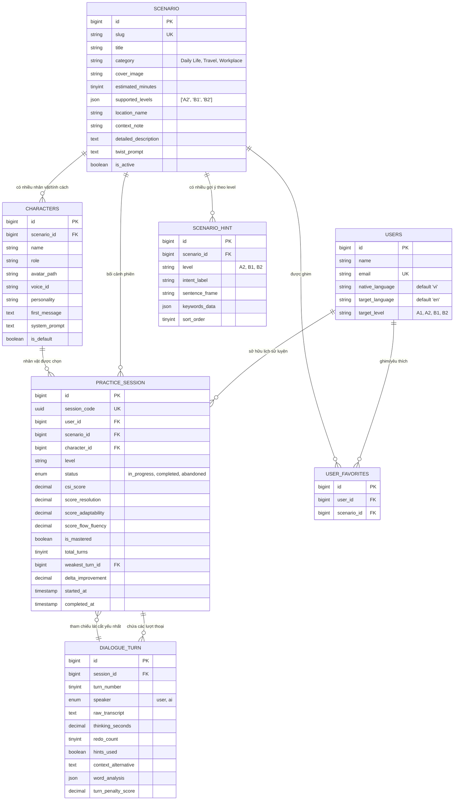

# ĐẶC TẢ THIẾT KẾ CƠ SỞ DỮ LIỆU
## (DATABASE SCHEMA & ARCHITECTURE SPECIFICATION - DBS)

* **Dự án:** AI-Powered Real-World English Communication Simulator
* **Mã tài liệu:** DBS-v1.2 (Added detailed_description for Rich Hover Peek)
* **Tài liệu tham chiếu:** [BUSINESS_ANALYSIS.md](file:///home/tmi-13/.gemini/antigravity/scratch/ai-english-simulator/docs/BUSINESS_ANALYSIS.md) | [BUSINESS_RULES.md](file:///home/tmi-13/.gemini/antigravity/scratch/ai-english-simulator/docs/BUSINESS_RULES.md) | [SYSTEM_LOGIC_SPECIFICATION.md](file:///home/tmi-13/.gemini/antigravity/scratch/ai-english-simulator/docs/SYSTEM_LOGIC_SPECIFICATION.md)
* **Trạng thái:** Active / Baseline

---

## 1. SƠ ĐỒ THỰC THỂ QUAN HỆ (ERD - MERMAID)



---

## 2. ĐẶC TẢ CHI TIẾT CÁC BẢNG DỮ LIỆU

### 2.1. Bảng `users` (Người học)
| Tên Cột | Kiểu Dữ Liệu | Ràng buộc | Mục đích |
| :--- | :--- | :--- | :--- |
| `id` | `unsignedBigInteger` | `PK, auto_increment` | Khóa chính |
| `name` | `string(100)` | `not null` | Tên người học hiển thị in-app |
| `email` | `string(150)` | `unique, index` | Email đăng nhập |
| `password` | `string(255)` | `not null` | Mật khẩu mã hóa bcrypt |
| `native_language` | `string(10)` | `default 'vi'` | Ngôn ngữ mẹ đẻ (để hiển thị gợi ý tiếng Việt) |
| `target_language` | `string(10)` | `default 'en'` | Ngôn ngữ muốn luyện tập |
| `target_level` | `enum('A1', 'A2', 'B1', 'B2')` | `default 'A2'` | Trình độ mục tiêu |
| `timestamps` | `timestamp` | `nullable` | `created_at`, `updated_at` |

---

### 2.2. Bảng `scenarios` (Bối cảnh Kịch bản)
| Tên Cột | Kiểu Dữ Liệu | Ràng buộc | Mục đích |
| :--- | :--- | :--- | :--- |
| `id` | `unsignedBigInteger` | `PK, auto_increment` | Khóa chính |
| `slug` | `string(100)` | `unique, index` | URL định danh |
| `title` | `string(255)` | `not null` | Tên tình huống hiển thị |
| `category` | `string(100)` | `not null` | Thể loại (vd: `'Daily Life'`, `'Travel'`, `'Workplace'`) |
| `cover_image` | `string(255)` | `nullable` | Ảnh bối cảnh hiển thị trên Card |
| `estimated_minutes` | `tinyInteger` | `default 5` | Thời gian khuyến nghị (vd: 3-5 phút) |
| `supported_levels` | `json` | `not null` | Mảng các level hỗ trợ (vd: `["A2", "B1", "B2"]`) |
| `location_name` | `string(150)` | `not null` | Địa điểm (vd: *"Central Brew Coffee"*) |
| `context_note` | `string(255)` | `not null` | Dòng gợi ý bối cảnh ngắn 1 câu |
| `detailed_description` | `text` | `not null` | Mô tả bối cảnh chi tiết phong phú (hiển thị khi hover preview) |
| `twist_prompt` | `text` | `not null` | Nội dung tình huống phát sinh thực tế ở lượt 3 |
| `is_active` | `boolean` | `default true` | Trạng thái hiển thị kịch bản |
| `timestamps` | `timestamp` | `nullable` | `created_at`, `updated_at` |

---

### 2.3. Bảng `user_favorites` (Lưu bài ghim / yêu thích)
| Tên Cột | Kiểu Dữ Liệu | Ràng buộc | Mục đích |
| :--- | :--- | :--- | :--- |
| `id` | `unsignedBigInteger` | `PK, auto_increment` | Khóa chính |
| `user_id` | `unsignedBigInteger` | `FK -> users.id` | Người dùng nào (`cascadeOnDelete`) |
| `scenario_id` | `unsignedBigInteger` | `FK -> scenarios.id` | Kịch bản nào (`cascadeOnDelete`) |
| `timestamps` | `timestamp` | `nullable` | `created_at`, `updated_at` (Dùng để lấy bài ghim mới nhất) |
| `unique_pair` | `unique(user_id, scenario_id)` | Ràng buộc | Tránh trùng lặp ghim 2 lần |

---

### 2.4. Bảng `characters` (Nhân vật đại diện / Personas)
| Tên Cột | Kiểu Dữ Liệu | Ràng buộc | Mục đích |
| :--- | :--- | :--- | :--- |
| `id` | `unsignedBigInteger` | `PK, auto_increment` | Khóa chính |
| `scenario_id` | `unsignedBigInteger` | `FK -> scenarios.id` | Thuộc kịch bản nào (`cascadeOnDelete`) |
| `name` | `string(100)` | `not null` | Tên nhân vật (vd: *"Emma"*, *"Jack"*) |
| `role` | `string(100)` | `not null` | Chức danh (vd: *"Friendly Barista"*, *"Rushed Barista"*) |
| `avatar_path` | `string(255)` | `nullable` | Đường dẫn asset Avatar |
| `voice_id` | `string(100)` | `nullable` | Mã giọng đọc TTS (vd: `en-US-EmmaNeural`) |
| `personality` | `string(255)` | `not null` | Mô tả tính cách ngắn |
| `first_message`| `text` | `not null` | Lời chào mở màn riêng của nhân vật này |
| `system_prompt`| `text` | `not null` | System Prompt phong cách giao tiếp cho Gemini |
| `is_default` | `boolean` | `default false` | Nhân vật mặc định được chọn khi vào kịch bản |
| `timestamps` | `timestamp` | `nullable` | `created_at`, `updated_at` |

---

### 2.5. Bảng `scenario_hints` (Giàn giáo gợi ý theo Level)
| Tên Cột | Kiểu Dữ Liệu | Ràng buộc | Mục đích |
| :--- | :--- | :--- | :--- |
| `id` | `unsignedBigInteger` | `PK, auto_increment` | Khóa chính |
| `scenario_id` | `unsignedBigInteger` | `FK -> scenarios.id` | Thuộc kịch bản nào (`cascadeOnDelete`) |
| `level` | `string(10)` | `default 'A2'` | Phân loại gợi ý theo level (`A2`, `B1`, `B2`) |
| `intent_label` | `string(255)` | `not null` | Ý định giao tiếp bằng tiếng Việt |
| `sentence_frame` | `string(255)` | `not null` | Khung câu rỗng: `Could I get [drink] with [milk], please?` |
| `keywords_data` | `json` | `not null` | Mảng từ khóa kèm IPA và link audio phát âm mẫu |
| `sort_order` | `tinyInteger` | `default 1` | Thứ tự hiển thị trong khay gợi ý |
| `timestamps` | `timestamp` | `nullable` | `created_at`, `updated_at` |

---

### 2.6. Bảng `practice_sessions` (Phiên luyện tập)
| Tên Cột | Kiểu Dữ Liệu | Ràng buộc | Mục đích |
| :--- | :--- | :--- | :--- |
| `id` | `unsignedBigInteger` | `PK, auto_increment` | Khóa chính |
| `session_code` | `uuid` | `unique, index` | Mã phiên gửi cho frontend |
| `user_id` | `unsignedBigInteger` | `FK -> users.id` | Người học nào |
| `scenario_id` | `unsignedBigInteger` | `FK -> scenarios.id` | Bối cảnh nào |
| `character_id` | `unsignedBigInteger` | `FK -> characters.id`| Nhân vật nào |
| `level` | `string(10)` | `default 'A2'` | Trình độ được chọn cho phiên này |
| `status` | `enum('in_progress', 'completed', 'abandoned')` | `default 'in_progress'` | Trạng thái phiên |
| `csi_score` | `decimal(5,2)` | `nullable` | Điểm CSI tổng hợp (0 - 100) |
| `score_resolution` | `decimal(5,2)` | `nullable` | Điểm hoàn thành trao đổi |
| `score_adaptability`| `decimal(5,2)` | `nullable` | Điểm phản xạ theo ngữ cảnh |
| `score_flow_fluency`| `decimal(5,2)` | `nullable` | Điểm nhịp điệu & dung lượng linh hoạt |
| `is_mastered` | `boolean` | `default false` | Đạt chuẩn nếu CSI $\ge 75\%$ |
| `total_turns` | `tinyInteger` | `default 0` | Tổng số lượt đối đáp |
| `weakest_turn_id` | `unsignedBigInteger` | `nullable` | Lượt thoại yếu nhất được chọn để luyện lại |
| `delta_improvement`| `decimal(5,2)` | `nullable` | Độ tự tin tăng thêm sau khi luyện lại lát cắt |
| `started_at` | `timestamp` | `useCurrent()` | Thời điểm bắt đầu |
| `completed_at` | `timestamp` | `nullable` | Thời điểm kết thúc |
| `timestamps` | `timestamp` | `nullable` | `created_at`, `updated_at` |

---

### 2.7. Bảng `dialogue_turns` (Chi tiết từng lượt thoại)
| Tên Cột | Kiểu Dữ Liệu | Ràng buộc | Mục đích |
| :--- | :--- | :--- | :--- |
| `id` | `unsignedBigInteger` | `PK, auto_increment` | Khóa chính |
| `session_id` | `unsignedBigInteger` | `FK -> practice_sessions.id` | Thuộc phiên nào (`cascadeOnDelete`) |
| `turn_number` | `tinyInteger` | `not null` | Thứ tự câu thoại (1, 2, 3...) |
| `speaker` | `enum('user', 'ai')` | `not null` | Người nói |
| `raw_transcript`| `text` | `not null` | Nội dung văn bản lời thoại |
| `thinking_seconds`| `decimal(4,1)` | `nullable` | Thời gian ngẫm nghĩ (giây) trước khi bấm gửi |
| `redo_count` | `tinyInteger` | `default 0` | Số lần bấm [Nói lại] ở lượt này |
| `hints_used` | `boolean` | `default false` | Lượt này có bấm mở gợi ý không |
| `context_alternative`| `text` | `nullable` | Gợi ý cách nói tự nhiên hơn của người bản xứ |
| `word_analysis` | `json` | `nullable` | Mảng tô màu Xanh/Cam/Đỏ từng từ |
| `turn_penalty_score`| `decimal(5,2)` | `nullable` | Điểm phạt để thuật toán tự động chọn lát cắt yếu nhất |
| `timestamps` | `timestamp` | `nullable` | `created_at`, `updated_at` |

---

## 3. TOÀN VĂN MÃ NGUỒN MIGRATION LARAVEL HOÀN CHỈNH

```php
<?php

use Illuminate\Database\Migrations\Migration;
use Illuminate\Database\Schema\Blueprint;
use Illuminate\Support\Facades\Schema;

return new class extends Migration {
    public function up(): void
    {
        // 1. Users (Người học)
        if (!Schema::hasTable('users')) {
            Schema::create('users', function (Blueprint $table) {
                $table->id();
                $table->string('name', 100);
                $table->string('email', 150)->unique();
                $table->string('password');
                $table->string('native_language', 10)->default('vi');
                $table->string('target_language', 10)->default('en');
                $table->enum('target_level', ['A1', 'A2', 'B1', 'B2'])->default('A2');
                $table->rememberToken();
                $table->timestamps();
            });
        }

        // 2. Scenarios (Bối cảnh Kịch bản)
        Schema::create('scenarios', function (Blueprint $table) {
            $table->id();
            $table->string('slug', 100)->unique();
            $table->string('title');
            $table->string('category', 100);
            $table->string('cover_image')->nullable();
            $table->tinyInteger('estimated_minutes')->default(5);
            $table->json('supported_levels');
            $table->string('location_name', 150);
            $table->string('context_note');
            $table->text('detailed_description'); // Mô tả bối cảnh chi tiết khi hover preview
            $table->text('twist_prompt');
            $table->boolean('is_active')->default(true);
            $table->timestamps();
        });

        // 3. User Favorites (Ghim / Yêu thích)
        Schema::create('user_favorites', function (Blueprint $table) {
            $table->id();
            $table->foreignId('user_id')->constrained('users')->cascadeOnDelete();
            $table->foreignId('scenario_id')->constrained('scenarios')->cascadeOnDelete();
            $table->timestamps();
            $table->unique(['user_id', 'scenario_id']);
        });

        // 4. Characters (Nhân vật đại diện tách riêng)
        Schema::create('characters', function (Blueprint $table) {
            $table->id();
            $table->foreignId('scenario_id')->constrained('scenarios')->cascadeOnDelete();
            $table->string('name', 100);
            $table->string('role', 100);
            $table->string('avatar_path')->nullable();
            $table->string('voice_id', 100)->nullable();
            $table->string('personality');
            $table->text('first_message');
            $table->text('system_prompt');
            $table->boolean('is_default')->default(false);
            $table->timestamps();
        });

        // 5. Scenario Hints (Giàn giáo gợi ý theo level)
        Schema::create('scenario_hints', function (Blueprint $table) {
            $table->id();
            $table->foreignId('scenario_id')->constrained('scenarios')->cascadeOnDelete();
            $table->string('level', 10)->default('A2');
            $table->string('intent_label');
            $table->string('sentence_frame');
            $table->json('keywords_data');
            $table->tinyInteger('sort_order')->default(1);
            $table->timestamps();
        });

        // 6. Practice Sessions (Phiên luyện tập)
        Schema::create('practice_sessions', function (Blueprint $table) {
            $table->id();
            $table->uuid('session_code')->unique();
            $table->foreignId('user_id')->constrained('users')->cascadeOnDelete();
            $table->foreignId('scenario_id')->constrained('scenarios');
            $table->foreignId('character_id')->constrained('characters');
            $table->string('level', 10)->default('A2');
            $table->enum('status', ['in_progress', 'completed', 'abandoned'])->default('in_progress');
            $table->decimal('csi_score', 5, 2)->nullable();
            $table->decimal('score_resolution', 5, 2)->nullable();
            $table->decimal('score_adaptability', 5, 2)->nullable();
            $table->decimal('score_flow_fluency', 5, 2)->nullable();
            $table->boolean('is_mastered')->default(false);
            $table->tinyInteger('total_turns')->default(0);
            $table->unsignedBigInteger('weakest_turn_id')->nullable();
            $table->decimal('delta_improvement', 5, 2)->nullable();
            $table->timestamp('started_at')->useCurrent();
            $table->timestamp('completed_at')->nullable();
            $table->timestamps();
        });

        // 7. Dialogue Turns (Lịch sử từng lượt đối đáp)
        Schema::create('dialogue_turns', function (Blueprint $table) {
            $table->id();
            $table->foreignId('session_id')->constrained('practice_sessions')->cascadeOnDelete();
            $table->tinyInteger('turn_number');
            $table->enum('speaker', ['user', 'ai']);
            $table->text('raw_transcript');
            $table->decimal('thinking_seconds', 4, 1)->nullable();
            $table->tinyInteger('redo_count')->default(0);
            $table->boolean('hints_used')->default(false);
            $table->text('context_alternative')->nullable();
            $table->json('word_analysis')->nullable();
            $table->decimal('turn_penalty_score', 5, 2)->nullable();
            $table->timestamps();
        });
    }

    public function down(): void
    {
        Schema::dropIfExists('dialogue_turns');
        Schema::dropIfExists('practice_sessions');
        Schema::dropIfExists('scenario_hints');
        Schema::dropIfExists('characters');
        Schema::dropIfExists('user_favorites');
        Schema::dropIfExists('scenarios');
    }
};
```
